# AREA — Action-REAction automation platform

> Connect your favorite services and automate them: *"when this happens on service A, do that on service B"* — on web and mobile.

<p align="center">
  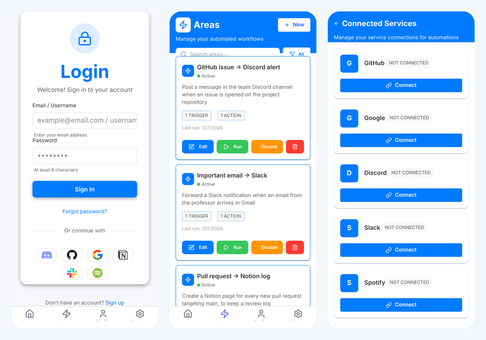
</p>
<p align="center">
  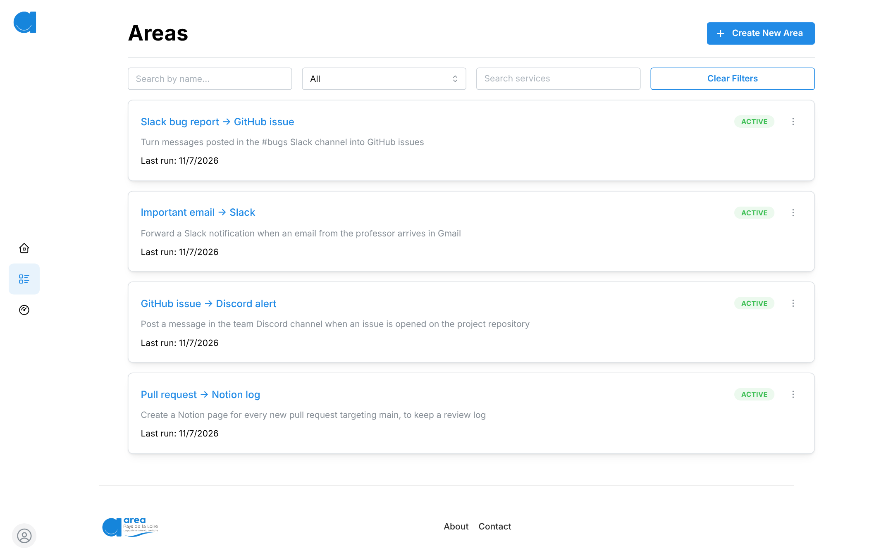
</p>

<sub>Screenshots from a local run of the full stack (backend, web, mobile) with a demo account and sample automations.</sub>

## Context

Third-year project at **Epitech** (Application Development module), built by a team of 5 over 7 weeks (15 Sept – 2 Nov 2025), using **Scrum** with weekly sprints: week 1 for proofs of concept and stack choice, then a project plan defense, an MVP defense and a final product defense.

## Project requirements

What Epitech expected for the project to be validated:

- An **application server** exposing a REST API, holding all the business logic — clients only display data and forward user actions
- A **web client** and a **mobile client** (Android APK), both talking exclusively to the server
- **User management**: registration, login, and login through third-party accounts (**OAuth2**)
- **Services** users can connect to, each offering **actions** (triggers: "a new issue is opened", "an email arrives"…) and **reactions** ("send a message", "create a file"…)
- **AREAs**: user-defined automations linking an action to one or more reactions, executed automatically by the server
- An `about.json` endpoint describing the available services, actions and reactions
- The whole stack (server, web client, mobile build) launched with a single `docker compose up`
- Documentation, tests and a clear project organization (planning, sprints, conventions)

## Features

- Account creation, login, password recovery and **OAuth2 login** (with PKCE on mobile)
- **6 connected services** (GitHub, Google, Discord, Notion, Slack, Spotify) and ~**55 actions/reactions** that users can chain into automations
- Area editor to create, edit and delete automations
- Web client and native mobile client (Android APK built automatically)
- Light/dark theme, **French/English** localization, accessibility-minded design tokens
- Monitoring stack (Prometheus, Grafana, Loki)

## Screenshots

| Web — home | Web — login with 6 OAuth providers |
|---|---|
| 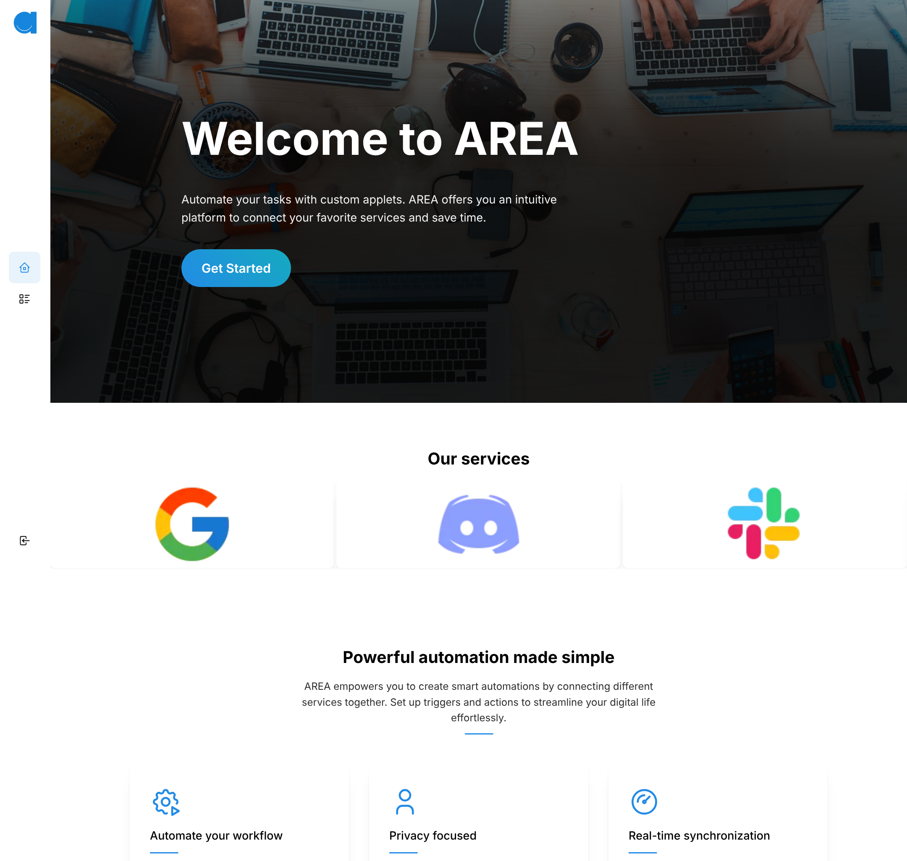 | 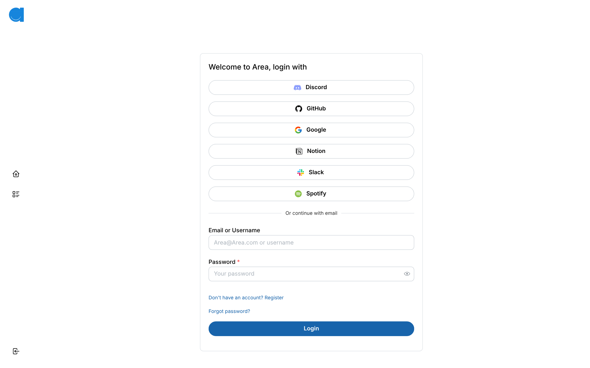 |

| Web — area editor: trigger step | Web — area editor: reaction step |
|---|---|
| 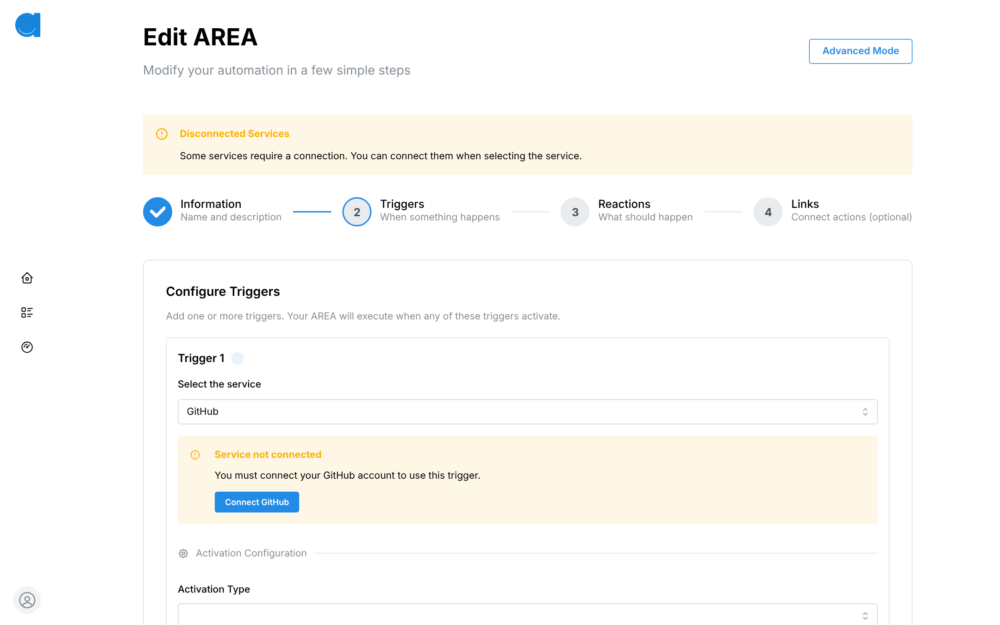 | 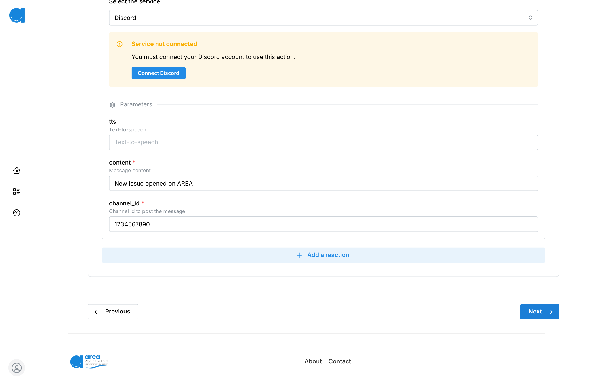 |

| Web — admin dashboard | Web — profile |
|---|---|
| 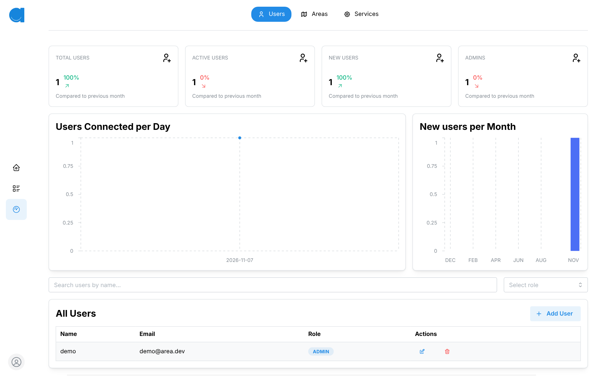 | 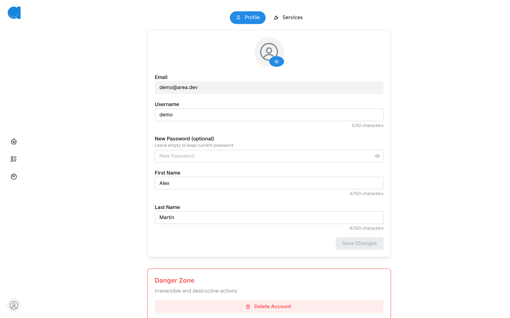 |

| Mobile — profile | Mobile — edit profile | Mobile — server settings |
|---|---|---|
| 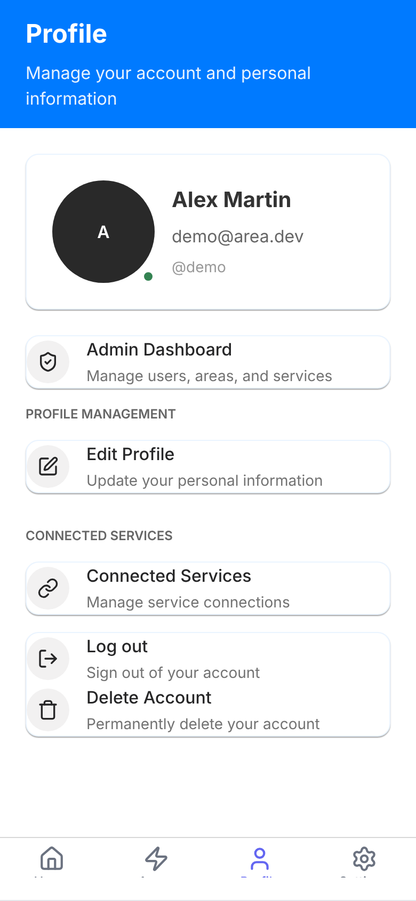 | 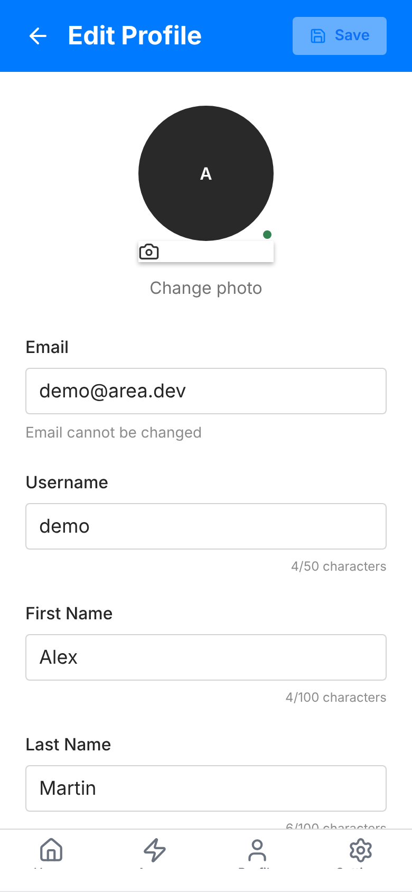 | 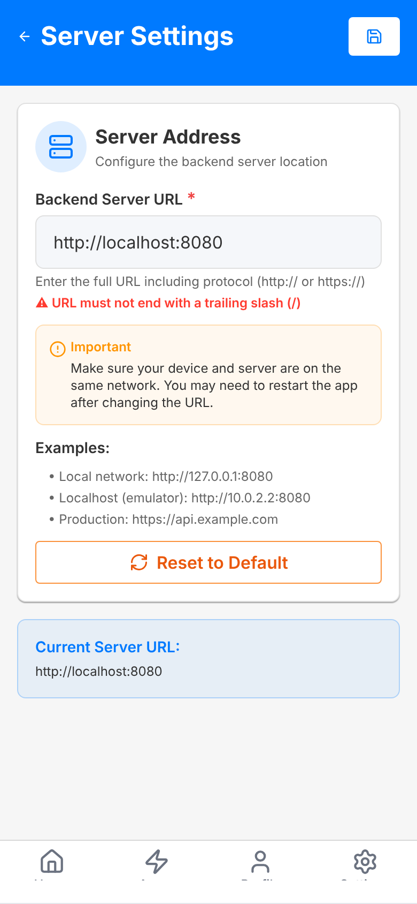 |

## Tech stack

| Layer | Technologies |
|---|---|
| Backend | Java, Spring Boot, PostgreSQL, Redis, Swagger |
| Web | Next.js (React), TypeScript, Cypress |
| Mobile | React Native, Expo Router, TypeScript, Gluestack UI, NativeWind (Tailwind), i18next, Jest |
| DevOps | Docker Compose, GitHub Actions, Prometheus, Grafana, Loki |

## Technical choices

Before writing any code, each team member benchmarked candidate technologies in short state-of-the-art studies and proofs of concept (Go, Java, Angular, Vue.js, React Native, NativeScript…). For the mobile client, I wrote the **React Native** and **NativeScript (TypeScript)** studies. The team then scored each option:

| Mobile stack | Speed | Simplicity | UX & performance | Ecosystem | Total /20 |
|---|---|---|---|---|---|
| **React Native** (PoC) | 5 | 4 | 4 | 5 | **18** |
| Flutter | 4 | 3 | 5 | 4 | 16 |
| NativeScript (PoC) | 3 | 3 | 3 | 3 | 12 |

The same process picked **Next.js** for the web (19/20) and **Java / Spring Boot** for the backend (17/20).

- **React Native + Expo** was chosen: the team already knew React (shared with the Next.js web client), Expo gives a fast developer experience and cloud builds, and the testing ecosystem (Jest, Testing Library) is mature.
- **Flutter** was kept as the fallback if performance or native integration became blocking.
- The study flagged **authentication / SSO** as the main mobile risk — which turned out to be exactly where we struggled (see below).

## Architecture

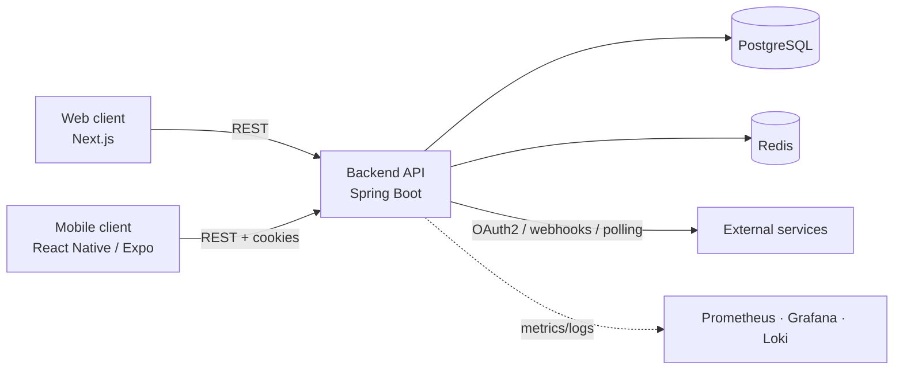

## Repository layout

During the project, the team worked in four repositories. This repository gathers them in one place, **with their full git history** (every commit keeps its original author):

| Folder | Original repository |
|---|---|
| `/` (docker compose, deployment) | [SamTess/AREA](https://github.com/SamTess/AREA) |
| `App/Back` | [SamTess/AREA_Back](https://github.com/SamTess/AREA_Back) |
| `App/Web` | [SamTess/AREA_Web](https://github.com/SamTess/AREA_Web) |
| `App/Mobile` | [SamTess/AREA_Mobile](https://github.com/SamTess/AREA_Mobile) |

The original setup guide written by the team is in [docs/SETUP.md](docs/SETUP.md).

## Try it in one command

Only Docker is needed. This starts the backend, the web client, PostgreSQL and Redis, then creates a demo account with sample automations:

```bash
git clone https://github.com/CarlosSB2028/AREA.git
cd AREA
docker compose -f docker-compose.demo.yml up --build
```

Then open **http://localhost:3000** and log in with **`demo@area.dev`** / **`DemoPassw0rd!`**.

The demo uses throwaway local values: you can browse the whole app, edit automations and use the admin dashboard, but logging in with GitHub/Google/… and running automations against real services requires your own OAuth credentials (see below). Stop it with `docker compose -f docker-compose.demo.yml down -v`.

## Getting started (full setup)

### Prerequisites

- Docker 24+ and Docker Compose 2.20+ (≈ 8 GB RAM free)
- For local development: Java 21 / Gradle wrapper, Node.js + Yarn, Expo (Android Studio emulator or a physical device)
- **OAuth apps you create yourself** on each provider you want to use (e.g. Google Cloud Console, GitHub Developer Settings), with the callback URLs pointing to your local server
- An SMTP account for email verification (optional for local tests)

### Option A — everything with Docker

```bash
cp App/Back/.env.example App/Back/.env   # database, Redis, JWT, SMTP and OAuth client IDs/secrets
docker compose up --build
```

| Service | URL |
|---|---|
| Web app | http://localhost:8081 |
| API + Swagger | http://localhost:8080/swagger-ui.html |
| Grafana | http://localhost:3000 |
| Mobile APK | `docker cp area-client-mobile:/output/client.apk ./client.apk` |

### Option B — run each part locally (development)

**1. Backend** (`App/Back`)

```bash
cp .env.example .env      # DB_HOST=localhost, DB_PORT=5432, REDIS_HOST=localhost, SPRING_PROFILES_ACTIVE=dev, OAuth credentials…
docker compose --env-file .env -f Docker/docker-compose.back.yaml up --build -d
# API on http://localhost:8080 — tests: ./gradlew test
```

**2. Web client** (`App/Web`)

```bash
yarn install
echo "NEXT_PUBLIC_API_BASE_URL=http://localhost:8080/api" > .env.local
yarn dev                  # http://localhost:3000
```

**3. Mobile client** (`App/Mobile`)

```bash
yarn install
cp .env.example .env      # EXPO_PUBLIC_USE_MOCK=false to use the real backend
yarn start                # or: yarn android
```

Then set the backend URL in the app's server settings — `http://10.0.2.2:8080` from the Android emulator, or your machine's local IP from a physical device.

> To try the UIs without a backend, enable the mock mode: `EXPO_PUBLIC_USE_MOCK=true` (mobile) and `NEXT_PUBLIC_USE_MOCK_DATA=true` (web).

## Team

| Member | Main role |
|---|---|
| [@SamTess](https://github.com/SamTess) | Backend — database, actions/reactions, API for the clients |
| [@ms-tristan](https://github.com/ms-tristan) | Backend — authentication, database, OAuth2 |
| [@ctalneau](https://github.com/ctalneau) | DevOps — CI/CD, Docker, deployment |
| [@marinlamy](https://github.com/marinlamy) | Web client |
| [@CarlosSB2028](https://github.com/CarlosSB2028) | Mobile client |

Everyone also contributed outside their main area (e.g. web and mobile features, tests and fixes).

## My contribution

I was in charge of the **mobile client** (React Native / Expo), with help from [@marinlamy](https://github.com/marinlamy) and [@ms-tristan](https://github.com/ms-tristan) on some features:

- **Project setup:** Expo Router structure, tab navigation, base screens, ESLint, Jest configuration and CI caching
- **Mobile design system:** reusable UI components (Gluestack + Tailwind), light/dark theme and a `useDesignTokens` hook to avoid hard-coded colors and prepare for WCAG compliance
- **Authentication:** login, registration and forgot-password flows aligned with the backend's cookie-based session, and **PKCE** for the OAuth2 flow
- **Screens:** profile editing (with unsaved-changes guard), action/reaction components, About and Help pages
- **Internationalization:** French/English with i18next and expo-localization
- **Quality:** unit tests for components and screens, coverage reports, contribution guide and PR template

## Known limitations / what I'd improve

**OAuth2 on mobile was my hardest ticket.** The ticket was planned for the MVP defense (early October), but I spent about three weeks on it (6 → 28 October 2025), restarting the implementation several times, including with AI assistance, without getting a working flow. I didn't communicate enough with the team during that time, even though they had their own tickets to handle. The flow finally came together once [@marinlamy](https://github.com/marinlamy) shared the OAuth service he had built for the web client and [@SamTess](https://github.com/SamTess) reworked the callback handling in the mobile app; I added PKCE on top.

At the team level, we also had to re-plan: for the MVP we shipped **a single OAuth2 provider first** and postponed the others to focus on actions and reactions. Our retrospective lessons were to give tickets more time than we think they need, complete the CI early, write tests, require two reviewers per pull request and keep a buffer week at the end.

What I'd do differently:

- **Start from the contract:** read what the backend actually expects (endpoints, redirect URIs, cookies) with the backend developer before writing any client code
- **Reuse what already works:** ask the teammate who solved the same problem on another client, instead of rebuilding it alone
- **Raise blockers early:** flag a ticket after a few days without progress, so the team can re-plan — and keep my time for the services and features the project actually required

## What I learned

- How an OAuth2 flow really works on mobile (authorization code, PKCE, redirect handling, cookie sessions) — and that it is a team integration problem, not a single-client one
- Building a small design system with tokens instead of hard-coded styles
- Working in a 5-person team with Scrum, conventional commits and PR reviews — and why asking for help early matters

---

*Epitech project — the original subject is not included in this repository. Code released under the [MIT License](LICENSE) © Samuel Tesson and the AREA team.*
